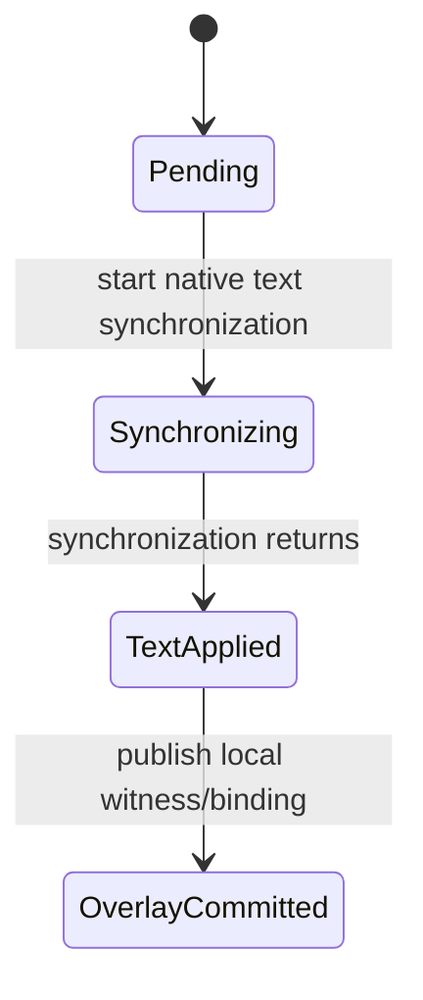

# Code quality implementation plan

Started: 2026-11-07. Baseline: `f720af73ceca774ae2ce0877c879139b73b621db`.

This is the current plan for lifecycle and module quality work. Earlier evaluation
documents describe historical implementations and results; their old progress
headings are not current task status. Completion evidence will identify the tested
source and binaries independently of this document.

## Constraints and scope

- Preserve supported behavior, diagnostic versions/order/ranges, navigation and
  completion results, unsaved text, cancellation and recovery semantics.
- Keep every existing experimental default unchanged and disabled. Do not add a
  mandatory debounce, change cache policy or expand freeze eligibility in a
  structural refactor. Semantic test caches remain unlimited.
- Preserve hot-path complexity, original semantic-object reuse and ownership
  lifetimes. Do not add routine graph traversals, locks, allocations or tracing.
- Finish one stage before starting implementation in the next. A contract defect
  discovered by later acceptance reopens its owning stage explicitly.
- Changes target the server coordination, overlay, diagnostics and cache ownership
  boundaries. The native SDK's semantics are preserved; its large Compilation
  implementation is not split merely to reduce file sizes.
- Temporary work belongs in a dedicated `untracked/code-quality-2026-11-07`
  directory. Keep reusable inputs/build caches, source identities, conclusions
  and data; remove ended logs, expired probes and duplicate generated projects.

## Ordered implementation and stage acceptance

| Stage | Implementation | Acceptance before proceeding |
| --- | --- | --- |
| Q1: lifecycle contracts | Inventory transition sites; give text synchronization and context retirement named transitions. Separate editable text, semantic binding, diagnostic readiness and retirement as orthogonal state domains. | Cancellation before/inside/after synchronization, local rejection, native fallback and deferred binding preserve exactly-once text application. Replacement publication, input admission and cancellation preserve existing retry decisions. No new hot-path work. |
| Q2: ownership boundaries | Keep a retained diagnostic analysis and its owning model together behind a named handle. Make borrowing, weak observation and owning retention explicit. Consolidate diagnostic capture/preparation attempts and their version/retry rules. | Old model/source lifetime survives an outstanding query; released views expire after consumers are dropped. Cancelled/failed capture can retry at the same existing boundaries. No ownership cycles, generation chains or changed destruction order. Targeted ASan and Native-result comparisons pass. |
| Q3: module responsibilities | Extract overlay input witnessing, query response adaptation and diagnostic coordination into distinct implementation units with narrow interfaces. Separate immutable diagnostic rendering reuse from binding/context replay. Isolate retirement coordination from ordinary protocol handlers where it can own its state and transitions. | Dependencies have one direction; input proof cannot publish, query adaptation cannot advance text, rendering cannot bind native symbols, and private candidate work cannot replace the live driver. Each extraction passes existing targeted tests before the next. No new feature flags or semantic algorithm changes. |
| Q4: expanded verification workloads | Add at least two substantial real UVM verification configurations to an opt-in workload set. Assess Ibex core UVM and OpenTitan chip-level DV first, reusing local pinned sources. Keep one new configuration out of implementation-time tuning. | Record provenance, configuration, actual loaded source/class/instance scale and unresolved dependencies. Analyze real code, without placeholder class/package stubs. Native and experimental public results agree through edit/error/repair/rebuild. Missing inputs are an explicit setup failure, not a successful test. |
| Q5: release acceptance | Run complete tests, existing-project regressions and new-workload checks; record observations, investigate material changes, clean artifacts and push main. | All correctness and packaging/restoration gates pass; experiments remain default-off; performance and memory changes are evaluated under matching configurations and frozen coverage. Publish code identities, data and limitations with the implementation, then verify the remote commit. |

## State and ownership contracts to enforce

### Document edit

`Pending` permits native fallback or a deferred local retry. Once synchronization
starts, replaying the same incremental range is forbidden even if synchronization
throws or cancellation arrives. A request-local transaction records that boundary;
its destructor does not secretly synchronize or publish. Deferred binding commits
text and its witness while leaving semantic binding unprepared.

### Model replacement and deferred input

Retirement request, pending editor admission and whether a replacement has ever
been published are distinct facts. They must not be collapsed into a single enum
whose states cannot represent existing combinations. A candidate owns its source
and semantic data privately until publication; cancellation drops the candidate
and keeps the current driver and latest editor input valid. Model publication
advances the epoch and resets history accounting together. A pending admission
must not accidentally serve a proof based on the preceding document text.

### Diagnostic capture and publication

Capture is tied to a document version and original completed analysis. A pending
capture is different from a prepared diagnostic cache. Cancellation is retryable;
an eligibility failure preserves its original reason until successful recapture
or a new eligible version. A diagnostic publication must revalidate current
inputs and the requested version. A rendered DTO can own text and positions;
native symbol/type/procedure pointers require an explicit owning analysis handle.

### Lifetime table

| Resource | Owner | Borrowing contract / release boundary |
| --- | --- | --- |
| Live document text and current driver | ServerDriver / SlangDoc | Applied once per notification; remains current across analysis cancellation. |
| Fixed semantic graph | ScopeBodyCache group or trusted library | Consumers pin the original owner; no chain of edited consumers. |
| Retained diagnostic baseline | Named analysis-owner handle | Raw procedures/symbols and analysis managers cannot outlive this handle. |
| Query-local source/tree/analysis | Query or overlay candidate | Dispose analysis/tree before releasing their source manager and pins. |
| Source buffer leases | Source storage registry / explicit pins | Shared storage is accounted once; observation alone uses weak ownership. |
| Diagnostic transport / immutable rendering DTO | Publication value | Pure rendering data must not retain a new semantic owner per edit. |

## Test and performance policy

Existing small regression tests remain the default suite. New large projects are
explicitly invoked integration/qualification workloads, not CTest dependencies.
When a large project reveals an uncovered lifecycle or language interaction,
reduce it to a deterministic point test: retain the ownership/transition feature,
remove unrelated design code and UVM where possible, and compare public behavior
with the native path. Include the failure trigger and expected recovery in the
test name and evidence. Do not invent a regression test for a concern that was
never observed or reasoned from a concrete code path.

Full acceptance uses the complete normal CTest suite, server and SDK ASan suites,
transport/text synchronization checks, installed default-off/UVM profile checks,
and SDK restoration integrity. Existing sixteen public-query projects cover
hover/definition/completion/resolve/references and diagnostic equivalence.
Real-edit checks cover first edit, continuous edits, incomplete text, repair,
line shifts, structural fallback, close/reopen and manual rebuild.

Qualified performance runs are serial after build and correctness jobs end.
Use the same binary/configuration/input identities, frozen coverage and unlimited
test caches. At minimum, repeat SoC and CVA6 real-edit and whole-design background
scenarios three times per arm/version, and run the complete existing real-edit
matrix for correctness. Include each new verification workload's startup, first
and continuous edit timings and current/lifetime-peak physical footprint.

Investigate increases above 50 ms in startup/edit/diagnostic medians, or above
5% and 20 MiB in memory; use absolute differences and sample ranges as well as
percentages. These are investigation triggers, not an invitation to discard bad
samples or retime unchanged code until it passes. Existing sub-50-ms measurements
may trade a small amount of latency for a documented structural benefit, provided
end-to-end behavior and queueing are checked. No universal p99 claim from three
process samples. Preserve original measurements and any follow-up evidence.

## Large workload selection

Prefer different verification structures over many labels for the same input:
parameterized agents, virtual interfaces/config DB, deep factory inheritance,
sequence/scoreboard interactions, task timing and driver contributions, and large
RTL+DV dependency closures. Measure the loaded design and verification portions
separately, including fixed and mutable code. Reuse pinned local sources first;
fetch a missing dependency once only if it is necessary, and retain its identity
for subsequent offline runs. OpenTitan block-level alternatives may support
diagnosis, but are reported as configurations of one codebase, not independent
projects. A successful subset analysis must be labelled as a subset.

## Progress

### Implemented responsibility boundaries

| Boundary | Implementation | Contract |
| --- | --- | --- |
| Applying editor text | `DocumentEditTransaction` | Records entry before native mutation; forbids replay through exceptions and cancellation. |
| Retirement facts | `ContextRetirementState` | Retry request, unadmitted input and publication history remain independent. |
| Borrowed diagnostic analyses | `DiagnosticAnalysisOwner` | Pins the analysis wrapper; task timing requires an actual task in that analysis. |
| Local diagnostic lifecycle | `LocalDiagnosticSession` | One capture/cache, versioned attempts, retryable cancellation and preserved failure provenance. |
| Physical input certification | `MethodInputProof` | Invocation-local descriptor access and full byte/path proofs; no semantic models or publication. |
| Preprocessor eligibility | `MethodPreprocessingProof` | Raw directive and inherited-macro checks; no semantic binding or persistent successful proof. |
| Certificate inputs | `MethodScopeCertificate.cpp` | Resolves a source/analysis context and captures witnesses; no editor text mutation. |
| Query response adaptation | `MethodScopeQueries.cpp` | Completion/navigation/hover/resolve values retain their existing protocol schema; no text synchronization. |
| Diagnostic orchestration | `MethodScopeDiagnostics.cpp` | Coordinates current-version preparation and publication through the session and existing cache. |
| Immutable rendering reuse | `BodyDiagnosticRendering.cpp`, `DiagnosticIdentity` | Pure record identity and snapshot rendering lookup; no binding or dataflow. |
| Context replacement | `SlangServerRetirement.cpp`, `SourceHistoryPolicy` | Existing private replacement, input admission and budget/retry policy, serialized by the server mutex. |

`ScopeBodyCache::Group` already owns its native compilation, body pointers and
optional completed analysis together; its pins observe released owners weakly.
`ActiveDesignContext` already retains its analysis wrapper. Their ownership
contracts are preserved rather than replaced with another generation chain.
Query teardown still releases analysis, tree and then its source manager/pins.

The module extraction keeps the native algorithms and checkpoint names. Physical
proof and pure diagnostic identity are reusable utilities; query, certificate and
diagnostic coordination remain implementation units of the same overlay facade.
They share value-only completion payload definitions rather than duplicating the
wire schema. Hash/equality helpers remain inline, and the new lifecycle/ownership
values add no mandatory graph copy, lock, worker or per-edit heap allocation.

- Q1: passed — explicit text transaction and orthogonal retirement events; all
  1073 server cases / 206745 assertions passed. Fixture root discovery now fails
  explicitly at the filesystem root; two point tests cover its termination.
- Q2: passed — retained analysis roles and diagnostic session own their lifecycle
  together. Normal and ASan suites both passed 1077 cases / 206788 assertions.
  Task timing selection is validated against an actual analyzed task.
- Q3: passed — six extraction gates each passed all 1077 server cases, followed
  by 1092/1092 CTest entries including SDK tests. New modules preserve the
  algorithms and checkpoint names; certificate construction has explicit phases.

- Q2/Q3 follow-up acceptance: analysis-owner moves now clear the source's borrowed
  views. Chip DV exposed generated command-line macro locations in diagnostic
  notes; a reduced test preserves real definition links and excludes generated
  buffer links. Final normal CTest passes 1093 entries; full ASan passes 1078
  server cases / 206828 assertions and 2650 SDK cases / 37128 assertions.
  The final macro-note filter borrows immutable source names and checks generated
  names before formatting, avoiding per-note path/string construction. All final
  normal, ASan, public-query and real-edit gates are rerun for this change.
- Q4: passed with explicit negative profiles — the opt-in EDAM preparation and
  LSP runner live in `tests/large_dv`; no external project enters CTest. USB
  device exercises actual retained RTL roots; SPI device exercises a refused
  import and correct native fallback. Both pass exact hover/diagnostic equality
  for 45 states each. UBUS, CVA6 and USB device pass full real-edit lifecycles
  under ASan. USB device was held out from production implementation tuning.
  Full-project metadata probes measure loaded physical HDL and semantic instance
  counts separately; lexical class declarations are not specialization counts.
- Q5: passed — correctness, installation, restoration and memory-lifetime gates
  passed for the final source. Serial qualification covers 20 before/after
  scenario comparisons, including two new DV configurations. Five startup
  investigation triggers received one fixed three-repeat follow-up each; none
  reproduced an increase above the investigation threshold. Frozen coverage and
  actual reuse evidence match between versions. Completed replay/install/probe
  outputs and logs were removed while reusable inputs/builds were retained.
  See [the evaluation](code-quality-evaluation.md) and its versioned data record.
  Publishing and verifying the containing main commit closes the active goal.

### New workload scope and limitations

The six added targets are configurations of one pinned OpenTitan repository,
not six independent projects. They cover full chip DV, OTBN, DMA, USB device and
both SPI roles. Actual loaded scale for the two complete lifecycle configurations
is below; the UVM contribution is included in the total and broken out separately.

| Configuration | Loaded HDL files / lines | Verification classes excluding UVM | Definition-name groups / instantiated symbols | UVM files / lines / classes |
| --- | --- | --- | --- | --- |
| USB device | 592 / 162364 | 233 | 63 / 735 | 142 / 75331 / 350 |
| SPI device | 559 / 175333 | 204 | 75 / 1641 | 142 / 75331 / 350 |

Hierarchy counts come from `slang.getScopesByModule`: groups use definition names
and include module/interface instances, excluding uninstantiated bodies. They
are not counts of generate blocks or unique generic class specializations.
The USB analysis profile starts without errors; SPI device currently starts with
14 Native errors as well as warnings. Its successful oracle means exact Native
equivalence through edits and recovery, not an error-free simulator configuration.

The chip EDAM inputs contain 659016 physical HDL lines and 1481 lexical DV class
declarations before UVM. Fixed package preparation reaches an invalid constant
state in `lc_state_to_bin` and declines after `$fatal`; adding the official
`TOP_LEVEL_DV` define does not remove that refusal. Baseline and candidate show
the same native-error refusal in the control. Vendored Ibex core UVM lacks two
`pulp_common_cells` inputs; that is a setup failure, not a successful corpus run.

DMA's 32/64-bit generic warning representative and OTBN's generic type-alias
warning spelling differ between native and experimental paths in both baseline
and candidate. Those exact payload comparisons remain failures and are not
normalized into passes. SPI host/device additionally demonstrate that preparing
a closure does not guarantee import: global-name dependencies can decline it.
SPI device's explicit fallback lifecycle still requires exact public equality.
These observations do not expand freeze eligibility during this refactor; they
are retained as future semantic-cache concerns. The generated-macro diagnostic
link defect was sufficiently isolated to fix and add to the ordinary point tests.
